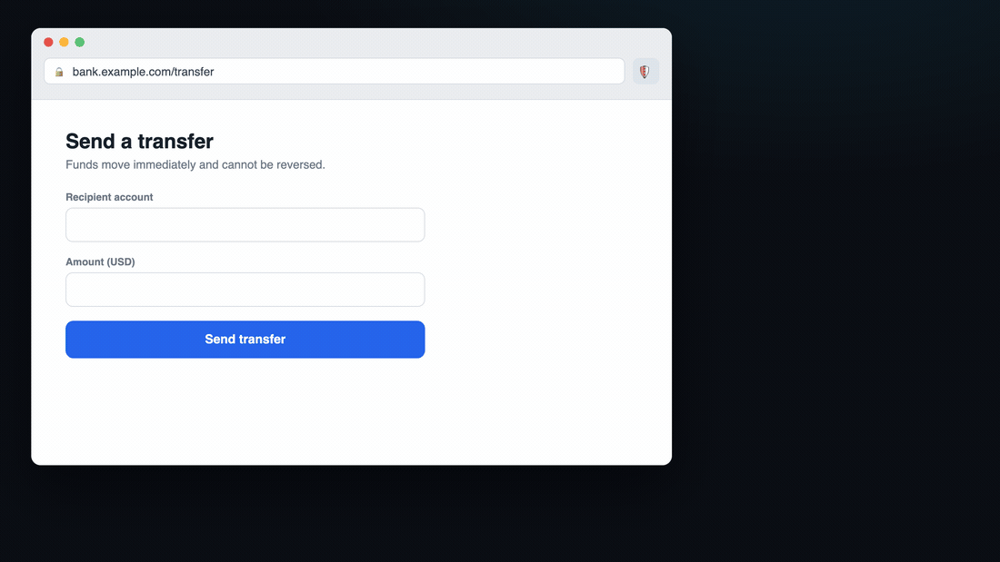

# AI Browser Guard

> **[OpenA2A](https://github.com/opena2a-org)**: [CLI](https://github.com/opena2a-org/opena2a) · [HackMyAgent](https://github.com/opena2a-org/hackmyagent) · [Secretless](https://github.com/opena2a-org/secretless-ai) · [AIM](https://github.com/opena2a-org/agent-identity-management) · **Browser Guard** · [DVAA](https://github.com/opena2a-org/damn-vulnerable-ai-agent)

[Website](https://opena2a.org/aibrowserguard) · [Privacy policy](https://opena2a.org/aibrowserguard/privacy) · [Discord](https://discord.gg/uRZa3KXgEn)

Chrome extension that detects and monitors AI agents operating in your browser (Playwright, Puppeteer, Selenium, Anthropic Computer Use, and OpenAI Operator) without requiring the agent to identify itself. It **cannot** block per-action input from external frameworks that drive the browser over CDP; against those it detects, alerts and closes the tab. See [Scope of enforcement](docs/enforcement-scope.md).

[Install from Chrome Web Store](https://chromewebstore.google.com/detail/ojphpdmabflmcjhglfogmkdgchkncikf)

An AI agent takes over a tab. AI Browser Guard detects it without the agent identifying itself, flags the transfer it tries to submit, and the kill switch (Ctrl+Shift+K) closes the tab the agent controls.

## What It Does

- **Detects agent takeover without notice**: browser-based AI agents can control your session via CDP, WebDriver, or behavioral automation. AI Browser Guard detects their presence using three independent detection layers: CDP debugger monitoring, V8 stack trace analysis, and environment fingerprinting. Detection works against external frameworks; enforcement does not (see Scope of enforcement).
- **Constrains in-page automation**: delegation rules define what an in-page/injected agent can do. Scripted navigations, form submissions, synthetic clicks and typing, and new-tab opens are blocked best-effort in the page realm, with a notification for each block. **This does not apply to external CDP frameworks**, which act via native input the page realm cannot intercept.
- **Logs what it can see**: page-realm agent actions are logged to a session timeline with timestamps, target URLs, elements, and outcomes (allowed/blocked). The last 5 sessions are retained. A session driven by an external CDP framework will show few or no actions **because its native input is not observable, not because nothing happened**. Reports state this scope explicitly.
- **Kill switch**: one-click stop. Revokes delegations, dispatches a page-realm stop to in-page automation, and **closes the tabs an agent controls** (the real interruption of an in-progress action). It does **not** terminate an external CDP session (an extension cannot), and a persistent external driver can reopen a tab. Keyboard shortcut: Ctrl+Shift+K / Cmd+Shift+K.

> **Scope of enforcement.** Detection and monitoring work against every framework above; per-action blocking does not. External frameworks drive the browser over CDP with native input the page realm cannot intercept, so against them AI Browser Guard detects, alerts, and closes the tab, but cannot enforce per-action policy. Downloads, and the Chrome policy that blocks remote debugging: [docs/enforcement-scope.md](docs/enforcement-scope.md).

> **Tabs with no detected agent.** A session delegation is the rule in a tab where no agent was detected too, and in-page blocking does not wait for a detection, so a page's own scripted `click`, `keydown`, `input` or `submit` event can be blocked there. What you see then, and how to let a site's own events through: [docs/enforcement-scope.md](docs/enforcement-scope.md#tabs-with-no-detected-agent).

## Install

**Chrome Web Store (recommended):**

[Install AI Browser Guard](https://chromewebstore.google.com/detail/ojphpdmabflmcjhglfogmkdgchkncikf): one click, automatic updates.

To build from source and load it unpacked: [docs/install.md](docs/install.md).

## Delegation Presets

| Preset | What the Agent Can Do |
|--------|----------------------|
| Read-Only | Navigate and read pages. No clicking, typing, or form submission. |
| Limited | Interact with specific sites (user-defined allowlist), with sites you explicitly block, time-bounded (15min/1hr/4hr). |
| Full Access | Every action on every site, for 60 minutes. The grant then expires: granted on an agent's card, the session delegation applies to that agent again; granted as the session delegation, no delegation is left in place. Actions are still logged. No boundary alerts fire while it lasts, because no action is outside it. |

> **These presets are enforced best-effort against in-page / injected automation, except downloads, which Read-Only and Limited can cancel in an agent's tab for every kind of agent.** External CDP frameworks bypass the rest; for those agents a preset is otherwise a recorded intent, not an enforced boundary, and the kill switch (close tab) is the hard stop.

Site glob patterns, ending a delegation, pausing the guard on a site, and opt-in browser-layer blocking: [docs/delegation.md](docs/delegation.md).

## Privacy

By default the extension makes zero network requests. All detection, delegation, and session tracking runs locally in the browser, and there is no analytics or telemetry.

### Network requests and telemetry

Four optional network features are **off by default** and only act after you explicitly enable them:

- **AIM identity lookup** (`aim.opena2a.org`) and **registry trust lookup** (`api.oa2a.org`): when an agent is detected, look up a trust score for that agent type. Only the detected agent type (for example `playwright`) is sent; never your URLs or page content.
- **Contribution** (`api.oa2a.org`): sends a random token kept on this install, the framework name and summary counts; never URLs, page content or keystrokes. A tip in the popup offers it after 5 detections or 3 days after the first detection.
- **Site safety declarations** (the site the agent is on): when an agent is detected on a page, read that site's [`/.well-known/ai-safety.txt`](https://datatracker.ietf.org/doc/draft-fane-ai-safety-txt/) and show what the site claims about its own content. This is the only feature that contacts a server we do not operate. It sends no cookies, no page address, and nothing about you.

Turn contribution off with the switch under Community Trust Data in the popup's Settings, and site safety declarations with Read site safety declarations. The two lookups have no switch in the popup. Each feature in full: [docs/privacy.md](docs/privacy.md); the policy: [opena2a.org/aibrowserguard/privacy](https://opena2a.org/aibrowserguard/privacy).

## Documentation

- [Scope of enforcement](docs/enforcement-scope.md): what is blocked, what is only detected, which downloads are cancelled, and blocking in tabs with no detected agent
- [Detected frameworks](docs/detected-frameworks.md): how each framework is detected and what each method was checked against
- [Delegation](docs/delegation.md): what a preset enforces, ending a delegation, pausing the guard, browser-layer blocking
- [Privacy](docs/privacy.md): each optional network feature in full
- [Install from source](docs/install.md)
- [Architecture](docs/architecture.md) and [design decisions](docs/adr/)
- [Status](STATUS.md), [CHANGELOG.md](CHANGELOG.md) and [CONTRIBUTING.md](CONTRIBUTING.md) (development commands)

## License

[Apache-2.0](LICENSE)

---

Part of the [OpenA2A](https://opena2a.org) ecosystem. See also: [HackMyAgent](https://github.com/opena2a-org/hackmyagent), [Secretless AI](https://github.com/opena2a-org/secretless-ai), [DVAA](https://github.com/opena2a-org/damn-vulnerable-ai-agent), [AIM](https://github.com/opena2a-org/agent-identity-management).
